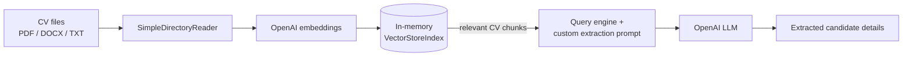

# 📄 OpenAI LLM-based CV Extractor

A lightweight CV/resume parser that uses **OpenAI models** through **LlamaIndex** to pull key candidate details out of unstructured CV documents (PDF, DOCX, TXT and more), with no hand-written parsing rules or templates.

Point it at a folder of CVs and it returns:

1. **Name**
2. **Email**
3. **Address**
4. **Mobile number**
5. **Previous experience**

---

## ✨ How it works



1. **Load**: `SimpleDirectoryReader` reads every supported file in the target folder.
2. **Index**: the text is chunked, embedded with OpenAI embeddings and stored in an in-memory `VectorStoreIndex`.
3. **Extract**: a custom prompt replaces LlamaIndex's default QA template. It instructs the LLM to act as an expert CV extractor and return the five fields above, **using only the CV content and not prior knowledge**.

---

## 📁 Project structure

```
OpenAI-LLM-based-CV-Extractor/
├── Data/
│   └── recreating-business-insiders-cv-of-marissa-mayer.pdf   # Sample CV
├── Scripts/
│   └── extractor.py                                           # Extraction pipeline
└── README.md
```

---

## 🛠️ Tech stack

| Component       | Tool                                  |
|-----------------|---------------------------------------|
| Orchestration   | LlamaIndex                            |
| LLM             | OpenAI (LlamaIndex default model)     |
| Embeddings      | OpenAI (LlamaIndex default model)     |
| Vector store    | LlamaIndex in-memory vector store     |
| Language        | Python 3.9+                           |

---

## 🚀 Getting started

### 1. Prerequisites

- Python 3.9 or newer
- An [OpenAI API key](https://platform.openai.com/api-keys) with available credit

### 2. Clone the repo and install dependencies

```bash
git clone https://github.com/LaksLaksman/OpenAI-LLM-based-CV-Extractor.git
cd OpenAI-LLM-based-CV-Extractor

pip install llama-index pypdf
```

`pypdf` lets LlamaIndex read PDF CVs. Add `docx2txt` if you also want to parse Word files.

### 3. Configure

In `Scripts/extractor.py`, set your OpenAI API key:

```python
os.environ["OPENAI_API_KEY"] = "your-api-key"
```

Point the reader at the folder that contains the CV(s):

```python
documents = SimpleDirectoryReader("../Data").load_data()
```

### 4. Run

```bash
cd Scripts
python extractor.py
```

### Example output

```
1. Name of the person: Marissa Mayer
2. Email of the person: ...
3. Address of the person: ...
4. Mobile number: ...
5. Previous experiences:
   - ...
```

---

## ⚙️ Customisation

- **Extract different fields**: edit the numbered list in `Extractor_prompt_tmpl_str`. You can add fields such as education, skills, certifications, LinkedIn URL or languages.
- **Choose specific models**: set them explicitly instead of relying on the defaults:

  ```python
  from llama_index.core import Settings
  from llama_index.llms.openai import OpenAI
  from llama_index.embeddings.openai import OpenAIEmbedding

  Settings.llm = OpenAI(model="gpt-4o-mini", temperature=0)
  Settings.embed_model = OpenAIEmbedding(model="text-embedding-3-small")
  ```

- **Retrieve more context**: long CVs can spread experience across many chunks, so increase how many chunks reach the LLM:

  ```python
  query_engine = index.as_query_engine(similarity_top_k=5)
  ```

---

## ⚠️ Limitations

- All files in the folder go into **one shared index**, so running it on several CVs at once can mix up candidates. Process one CV per run, or build one index per file.
- The output is free text, not structured data.
- CVs are sent to the OpenAI API. Make sure you have consent to process the candidates' personal data and that this complies with GDPR or other applicable rules.

---

## 🗺️ Roadmap

- [ ] Load the API key from a `.env` file instead of hard-coding it
- [ ] Add a `requirements.txt`
- [ ] Return structured JSON (e.g. Pydantic output parsing) for easy export to CSV or an ATS
- [ ] Batch-process a folder of CVs, one result per candidate
- [ ] Extract education, skills and certifications
- [ ] Add a simple upload UI (Streamlit / Gradio)
- [ ] Support local models (e.g. Ollama) for privacy-sensitive use

---

## 👤 Author

**Laks Laksman**: [GitHub](https://github.com/LaksLaksman)

Contributions, issues and suggestions are welcome.
